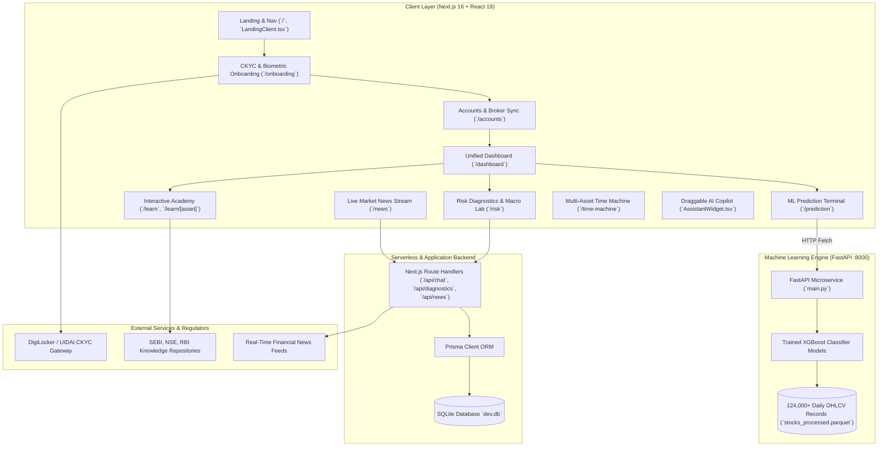

<div align="center">


### **All Your Investments, In One Place 🚀**

**An Institutional-Grade Multi-Broker Wealth Telemetry, Machine Learning Forecasting & Risk Advisory Engine**

[-black?style=for-the-badge&logo=next.js)](https://nextjs.org/)
[](https://react.dev/)
[](https://www.typescriptlang.org/)
[](https://tailwindcss.com/)
[](https://fastapi.tiangolo.com/)
[](https://xgboost.readthedocs.io/)
[](https://www.prisma.io/)

*Engineered for **Hack-On-Tracks** by a 4-member student engineering team.*

[Features](#-core-platform-capabilities) • [System Architecture](#-system-architecture) • [Live Video & Modules](#-complete-module-walkthrough) • [Mathematical Formulations](#-risk-engine-mathematics--regulatory-guardrails) • [Local Setup](#-local-installation--quickstart-guide) • [Team](#-engineering-team)

---

</div>

## 📌 Executive Summary & Problem Statement

Indian retail investors face severe portfolio fragmentation across segregated brokerage ecosystems (**Zerodha Kite, Groww, Upstox Pro, Angel One, ICICI Direct**). This fragmentation introduces structural friction, hidden fee leakages, and opaque risk exposure:

1. **Depository Fee Leakage**: Holding identical scrips across multiple brokers drains investment capital via duplicate annual Depository Participant (DP) charges (~₹420/year per duplicated stock holding).
2. **Opaque Multi-Asset Risk Exposure**: Retail investors cannot calculate their true portfolio-level annualized volatility ($\sigma$), Herfindahl-Hirschman asset concentration (HHI), or 95% Value-at-Risk (VaR) across segregated accounts.
3. **Speculative Decision Making**: Over-reliance on social media noise and unverified tips rather than statistical machine learning directional probabilities, cross-asset correlations, and macroeconomic stress-testing.
4. **Complex Asset Knowledge Gap**: High-yield and defensive asset classes (REITs, InvITs, G-Sec/SDL Bonds, Gold/Index ETFs, Derivatives) remain largely misunderstood or ignored by retail investors.

### 💡 The Unify Solution
**Unify** consolidates multi-broker telemetry into a single, real-time operating system. The platform integrates:
- **Government CKYC & WebRTC Live Biometric Authentication**: Verified against NSDL, DigiLocker, and UIDAI Aadhaar.
- **Client-Side Financial P&L Validator**: Real-time contract-note & CAS statement parsing with automatic duplicate scrip detection.
- **Trader Classification Synchronization**: Instant profile-matching across *Fresher*, *Beginner*, *Intermediate*, *Advanced*, and *Pro* tiers.
- **Institutional Multi-Scenario Risk Lab**: Value-at-Risk (VaR), 7×7 cross-asset correlation matrix, macro shock testing (RBI repo rate hike, tech correction, crude spike), and 1-click defensive basket rebalancing.
- **XGBoost Machine Learning Stock Prediction Microservice**: Trained on 124,000+ daily OHLCV historical records across 50 Indian equities.
- **Interactive Financial Masterclasses with Visual Metaphors**: 7 modules (Stocks, MFs, ETFs, Bonds, REITs, InvITs, F&O) equipped with dynamic concept simulators, 5-question mastery quizzes, and vetted SEBI/NSE/RBI knowledge vaults.

---

## 🏗️ System Architecture



---

## ⚡ Core Platform Capabilities

### 1. 🆔 Government CKYC & WebRTC Live Biometric Authentication (`/onboarding`)
- **8-Step Frictionless Identity Pipeline**:
  1. **Investor Profile**: Collects personal details with keyboard `<Enter>` rapid navigation.
  2. **NSDL Depository PAN Verification**: Live NSDL verification with official branding.
  3. **Mobile OTP Verification**: 6-digit OTP verification with instant demo-testing bypass.
  4. **DigiLocker & UIDAI Aadhaar CKYC**: Redirects to verified `digilocker.gov.in` retrieval gateway with Aadhaar branding.
  5. **WebRTC Camera Biometric Face Auth**: Real camera feed integration, face mesh alignment ring, active laser scanner animation, and biometric hash match.
  6. **Multi-Broker Connection & P&L File Ingestion**:
     - Connect Zerodha Kite, Groww, Upstox Pro, Angel One, and CDSL CAS.
     - **Client-Side Financial P&L Validator**: Inspects uploaded files (`.pdf`, `.csv`, `.xlsx`) against financial contract note keywords (`P&L`, `Tax`, `CAS`, `Holdings`, `ISIN`), blocking non-financial files.
     - **Interactive P&L Download Guides**: Step-by-step instructions for extracting verified statements from each broker.
  7. **Trader Classification Assessment**: Automatically assesses risk profile and categorizes investor as **Fresher**, **Beginner**, **Intermediate**, **Advanced**, or **Pro Trader**.

---

### 2. 📊 Consolidated Multi-Broker Telemetry Dashboard (`/dashboard`)
- **Cross-Broker Aggregation**: Aggregates net portfolio valuation, unrealized P&L, day change, and asset allocations across all connected brokerages.
- **Active Trader Tier Synchronization**: Synchronizes live telemetry with the user's selected trader classification level (`Fresher`, `Beginner`, `Intermediate`, `Advanced`, `Pro`).
- **Interactive Trajectory Benchmark Graph**: Interactive multi-timeframe chart (`1M`, `6M`, `1Y`, `3Y`, `ALL`) allowing live alpha benchmarking against **Nifty 50**, **Sensex**, or **Gold**.
- **Scrip Overlap & DP Fee Leak Detection**: Scans multi-broker portfolios for duplicate stock holdings (e.g., holding Reliance on both Zerodha and Groww) and computes annual Depository Participant (DP) fee savings.
- **Granular Asset Allocation**: Recharts interactive donut visualization breaking down holdings across Stocks, Mutual Funds, ETFs, Bonds, REITs, InvITs, and Cash.

---

### 3. 🛡️ Portfolio Risk Diagnostic & Macro Stress-Testing Lab (`/risk`)
- **Composite Risk Score (0–100)**: Evaluates weighted portfolio risk based on Annualized Volatility ($\sigma$), Herfindahl Concentration Index (HHI), Maximum Historical Drawdown (MDD), and derivative leverage penalties.
- **6 Core Quantitative Risk Metrics**:
  - **Annualized Volatility ($\sigma_{\text{ann}}$)**: Standard deviation over 252 trading days.
  - **95% 1-Month Value-at-Risk (VaR in ₹)**: Maximum expected rupee drawdown at a 95% confidence interval.
  - **Maximum Historical Drawdown (MDD %)**: Peak-to-trough crash decline percentage.
  - **Herfindahl Concentration Index (HHI)**: Asset class over-concentration metric.
  - **Sharpe Ratio Efficiency**: Risk-adjusted excess return over the 6.5% risk-free rate.
- **Live Unify AI Risk Copilot**: Context-aware assistant integrated into `/api/chat` with 1-click prompt pills for:
  - *"Simulate an RBI 50 bps repo hike"*
  - *"How does a 15% tech sector correction impact my holdings?"*
  - *"Recommend a defensive hedging basket"*
  - *"Explain my 95% 1-Month Value-at-Risk in plain English"*
- **Macroeconomic Stress-Testing Lab**: Run instant scenario shocks calculating projected portfolio valuation, rupee P&L loss, and stressed VaR:
  - 📉 *Tech Bubble Correction (-18.4% Tech, +3.1% Bonds)*
  - 🏦 *RBI 50 bps Repo Rate Hike (-4.2% Equities, -1.8% Long Bonds, +0.8% Liquid Funds)*
  - 🛢️ *Global Crude Oil Spike (+22% Energy, -6.8% Financials & FMCG)*
  - 🛡️ *1-Click Defensive Rebalancing Basket Deployment* modal linked to execution.

---

### 4. 🤖 XGBoost ML Stock Directional Prediction Engine (`/prediction`)
- **FastAPI Machine Learning Microservice**: Python backend trained on **124,000+ daily OHLCV historical records** across 50 top Indian equities.
- **Strict Chronological Data Split**: 80/20 train/test split with zero future lookahead data leakage.
- **Feature Engineering Pipeline**:
  - 14-day Relative Strength Index (RSI)
  - 10-day and 50-day Exponential Moving Average (EMA) ratios
  - 20-day rolling annualized volatility
  - Lagged price returns (`return_1d`, `return_5d`)
  - Volume momentum and OBV indicators
- **Institutional Telemetry Output**: Directional prediction (*Bullish* vs. *Bearish*), probability confidence percentage, test set accuracy vs. naïve baseline, precision, recall, F1-score, feature importance rankings, and confusion matrix.

---

### 5. 📚 Interactive Financial Masterclasses & Knowledge Academy (`/learn`, `/learn/[asset]`)
- **7 Asset Class Curriculum**: Dedicated modules for **Stocks**, **Mutual Funds**, **ETFs**, **Bonds**, **REITs**, **InvITs**, and **Futures & Options (F&O)**.
- **Interactive Visual Concept Simulators**:
  - 🏢 **REIT Skyscraper Simulator**: Build commercial Grade-A office floors and watch rental yield dividends accrue with high-contrast UI.
  - 🍕 **Pizza Diversification Visualizer**: Slice allocator illustrating equity risk vs. mutual fund basket diversification.
  - 🪙 **Bond Certificate & Coupon Streamer**: Simulate sovereign G-Sec yield drops and coupon cash distributions.
  - 🚗 **InvIT Toll Highway Plaza**: Toll revenue collection simulator demonstrating infrastructure cash flows.
  - 🛡️ **F&O Leverage Shield**: Call/Put position multiplier demonstrating asymmetric risk and theta time decay.
- **Interactive Knowledge Challenges (5 Questions Per Module)**:
  - 5 comprehensive, content-grounded multiple choice questions for every single module.
  - Step-by-step interactive quiz stepper with live progress bar and instant score counter.
  - High-contrast immediate answer feedback with detailed educational explanations.
  - Completion trophy screen with percentage score and full review breakdown.
- **Curated Official Knowledge Vault**:
  - High-contrast, structured knowledge cards linking to official regulatory resources:
  - **SEBI Official Portals**: SCORES 2.0, Investor Charter, and F&O Retail Loss Empirical Study (9/10 traders study).
  - **NSE India Portals**: Order book matching guides, swing trading telemetry, ETF handbooks, and InvIT portals.
  - **RBI Retail Direct**: Gilt account walkthroughs, Treasury Bills, and Sovereign Green Bonds.
  - **Institutional Masterclasses**: In-app YouTube video modal player with zero distractions.

---

### 6. 📰 Animated Financial Market News Stream (`/news`)
- **Live Financial News Aggregator**: Real-time business updates ingested from **The Economic Times, Times of India (Business), Moneycontrol, Financial Express, and Reuters**.
- **Automated Sentiment Classification**: Filter headlines by sentiment tag (*BULLISH / BEARISH / NEUTRAL*), market impact, and publisher category.
- **Fluid Animation**: Framer Motion staggered entrance animations with live market ticker indicators.

---

### 7. ⏰ Multi-Asset Time Machine Historical SIP Simulator (`/time-machine`)
- **Historical Backtesting Engine**: Simulate Lump Sum and Monthly SIP compounding growth across Equities, Bonds, REITs, InvITs, and Mutual Funds over custom date ranges.
- **Drawdown & Pain Index Analytics**: Calculates historical CAGR, Maximum Historical Drawdown, and rolling calendar year returns.

---

### 8. 💬 Draggable Unify AI Financial Assistant (`AssistantWidget.tsx`, `/api/chat`)
- **Viewport-Free Draggable Panel**: Floating assistant window with drag handles that can be freely positioned anywhere on the screen.
- **Structured Typography & Markdown Parser**: Renders formatted markdown, numbered badges, bullet points, and clickable in-app navigation pills (`/risk`, `/prediction`, `/learn`).
- **Conversational Awareness**: Contextually understands user portfolio metrics, answered quizzes, and macro scenarios.

---

## 📐 Risk Engine Mathematics & Regulatory Guardrails

The composite Portfolio Risk Score ($0 \le R \le 100$) is computed in [`src/lib/risk-analytics.ts`](file:///Users/aadiityaagarrwal/Desktop/Hack_On_Tracks/src/lib/risk-analytics.ts):

$$R = 0.40 \cdot S_{\text{vol}} + 0.30 \cdot S_{\text{conc}} + 0.30 \cdot S_{\text{drawdown}} + P_{\text{leverage}}$$

### 1. Annualized Portfolio Volatility ($S_{\text{vol}}$)
Computed via the 7×7 cross-asset covariance matrix ($\mathbf{\Sigma}$) scaled over a 252-day Indian trading year:

$$\sigma_{\text{ann}} = \sqrt{252 \cdot \mathbf{w}^T \mathbf{\Sigma} \mathbf{w}}$$

Where $\mathbf{w} = [w_{\text{stocks}}, w_{\text{mfs}}, w_{\text{etfs}}, w_{\text{bonds}}, w_{\text{reits}}, w_{\text{invits}}, w_{\text{fno}}]^T$ represents the normalized portfolio asset weight vector ($\sum w_i = 1$).

### 2. Herfindahl-Hirschman Concentration Index ($S_{\text{conc}}$)
Quantifies single-asset or single-domain over-concentration:

$$\text{HHI} = \sum_{i=1}^{7} (w_i \cdot 100)^2 \quad \implies \quad S_{\text{conc}} = \min\left(100, \frac{\text{HHI}}{100}\right)$$

### 3. Maximum Historical Drawdown ($S_{\text{drawdown}}$)
Weighted historical stress decline computed from historical crash profiles (e.g., 2008 GFC, 2020 COVID shock):

$$\text{MDD} = \sum_{i=1}^{7} w_i \cdot \text{MDD}_i$$

### 4. Parametric 95% 1-Month Value-at-Risk ($\text{VaR}_{95\%}$)
Estimated 30-day maximum capital loss at a 95% confidence interval ($z = 1.645$):

$$\text{VaR}_{95\%} = \text{Portfolio Value} \times 1.645 \times \frac{\sigma_{\text{ann}}}{\sqrt{12}}$$

---

## 💻 Tech Stack & Dependencies

| Layer | Technologies |
| :--- | :--- |
| **Frontend Framework** | **Next.js 16.4.0 (Turbopack)**, **React 19.3.0**, **TypeScript 5** |
| **Styling & Design System** | **Tailwind CSS v4.0**, CSS Variables, Dark/Light Theme Switching |
| **Animation & Motion** | **Framer Motion 14.0**, Custom SVG Canvas Visualizers |
| **Data Visualization** | **Recharts 3.10.1**, Custom Canvas Visualizers, SVG Gauges |
| **Backend & APIs** | Next.js App Router API Routes (`/api/chat`, `/api/diagnostics`, `/api/news`) |
| **Database & ORM** | **Prisma 6.19.3**, SQLite Database (`prisma/dev.db`) |
| **Machine Learning Service** | **Python 3.9+**, **FastAPI**, **XGBoost Classifier**, **scikit-learn**, **pandas** |
| **Historical Dataset** | **124,000+ Daily Records** across 50 Indian Equities (`stocks_processed.parquet`) |
| **Identity & Biometrics** | **WebRTC MediaStream Camera API**, Canvas Image Hashing, DigiLocker Gateway |

---

## 🚀 Local Installation & Quickstart Guide

### Prerequisites
- **Node.js**: `v18.0.0` or higher (Recommended: Node `v20+`)
- **npm**: `v9.0.0` or higher
- **Python**: `v3.9` or higher

---

### Step 1: Clone Repository
```bash
git clone https://github.com/aadiitya2007/Hack_On_Tracks.git
cd Hack_On_Tracks
```

### Step 2: Install Frontend Dependencies & Setup Database
```bash
# 1. Install Node.js dependencies
npm install

# 2. Generate Prisma Client
npx prisma generate

# 3. Synchronize database schema (SQLite)
npx prisma db push --accept-data-loss

# 4. Seed initial telemetry and portfolio records
npx tsx scripts/seed-prod.ts
```

### Step 3: Setup Python ML Service & Train XGBoost Models
```bash
# 1. Create and activate Python virtual environment
python3 -m venv data_venv
source data_venv/bin/activate       # On Windows: data_venv\Scripts\activate

# 2. Install ML requirements
pip install -r ml-service/requirements.txt

# 3. Train XGBoost classifier on the 124,000+ record Parquet dataset
cd ml-service
python train.py
cd ..
```

### Step 4: Run Application Services

#### Terminal 1: Next.js Frontend Server
```bash
npm run dev
```
> The application will be live at: **`http://localhost:3000`**

#### Terminal 2: FastAPI Machine Learning Service
```bash
source data_venv/bin/activate
cd ml-service
uvicorn main:app --host 0.0.0.0 --port 8000 --reload
```
> The FastAPI service will be live at: **`http://localhost:8000`** (Docs at `/docs`)

---

## 🧪 Verification & Production Build

To verify that all types, static routes, server components, and styling compile without errors:

```bash
# Run production build
npm run build
```

Expected output:
```text
▲ Next.js 16.4.0 (Turbopack)
✓ Compiled successfully
✓ Generating static pages (23/23)
✓ Finalizing page optimization
```

---

## 👥 Engineering Team

Engineered with passion for **Hack-On-Tracks**:

| Name | Role & Core Contribution | Focus Disciplines |
| :--- | :--- | :--- |
| **Aadiitya Agarrwal** | **Lead Systems Architect & Full-Stack Engineer**<br>Spearheaded multi-broker ingestion pipelines, client-side cryptographic isolation, and Next.js 16 Turbopack serverless architecture. | Next.js 16, Depository Ingestion, Cryptographic Isolation, Architecture |
| **Aryan Amilkanthwar** | **ML Specialist & Quantitative Systems Engineer**<br>Engineered statistical volatility distributions, backtesting pipelines, and XGBoost algorithmic return projection models. | XGBoost, Scikit-Learn, Statistical Risk Engines, Volatility Modeling |
| **Advait Ambarkar** | **Frontend Architect & Design Systems Lead**<br>Crafted Unify’s design language, responsive motion, micro-interactions, dark-mode visual hierarchy, and cross-device financial UX. | Tailwind CSS, Framer Motion, Interactive Canvas, Design Systems |
| **Tanay Bhutada** | **Financial Logic & Regulatory Systems Engineer**<br>Designed the mathematical tax-harvesting engine under Indian Income Tax Act Sections 70 & 71, CAS statement parsers, and SEBI guardrails. | Income Tax Act Sec 70/71, CAS Ingestion, SEBI Regulatory Framework |

---

## 🛡️ Compliance & Educational Disclaimer

**Unify** is an experimental fintech platform developed for competition and demonstration purposes. All predictions, probability scores, risk diagnostic calculations, and simulations are statistical models intended strictly for analytical and educational purposes. Unify does not provide SEBI-registered investment advice or individual buy/sell recommendations.

---

<div align="center">
  <b>Built with ❤️ by Team Unify for Hack-On-Tracks</b>
</div>
