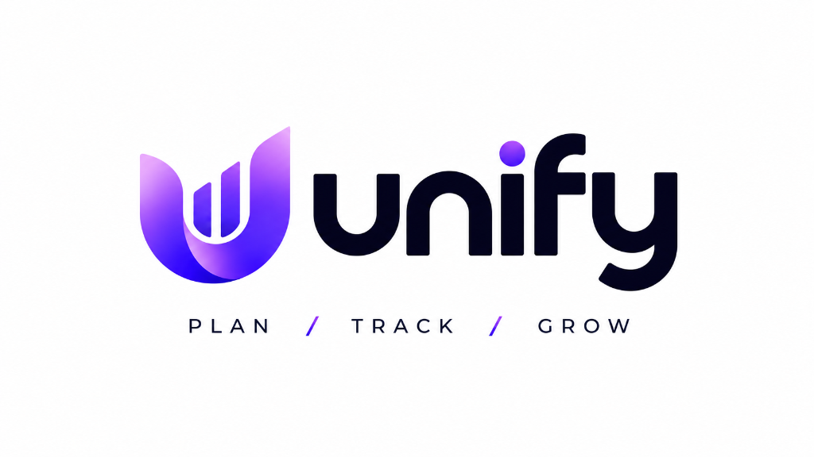
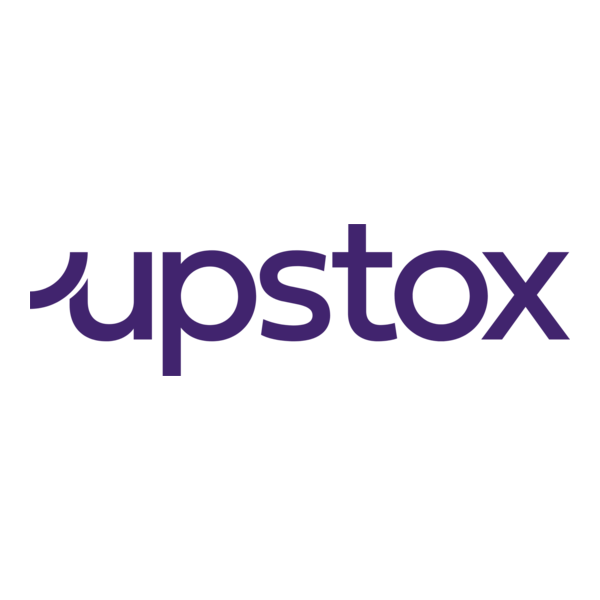
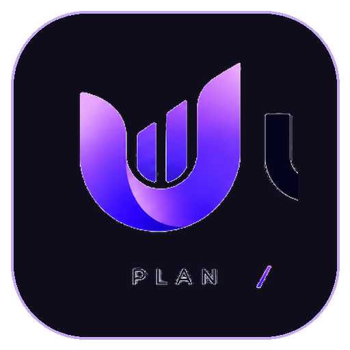
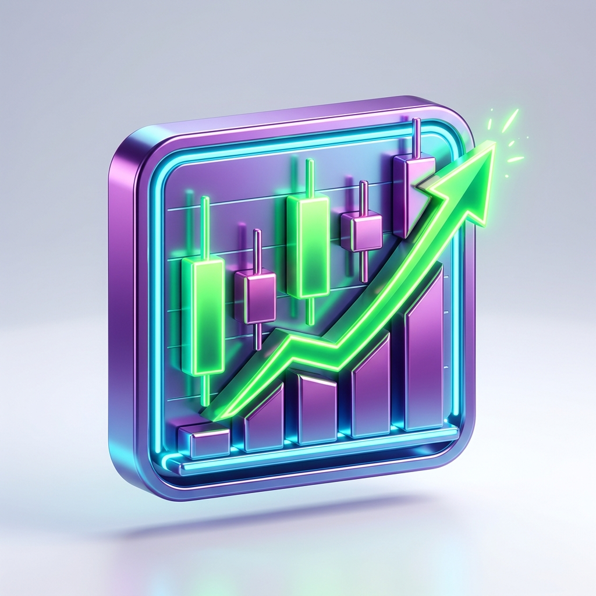
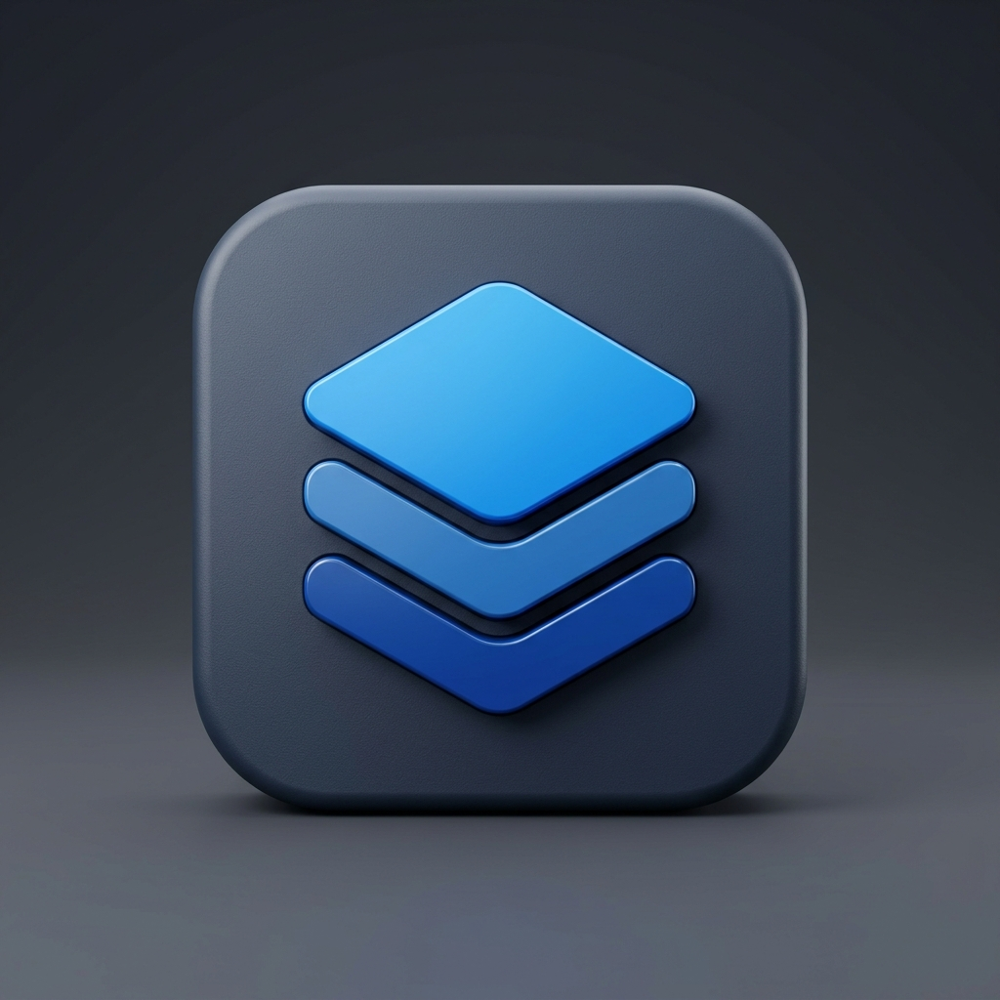
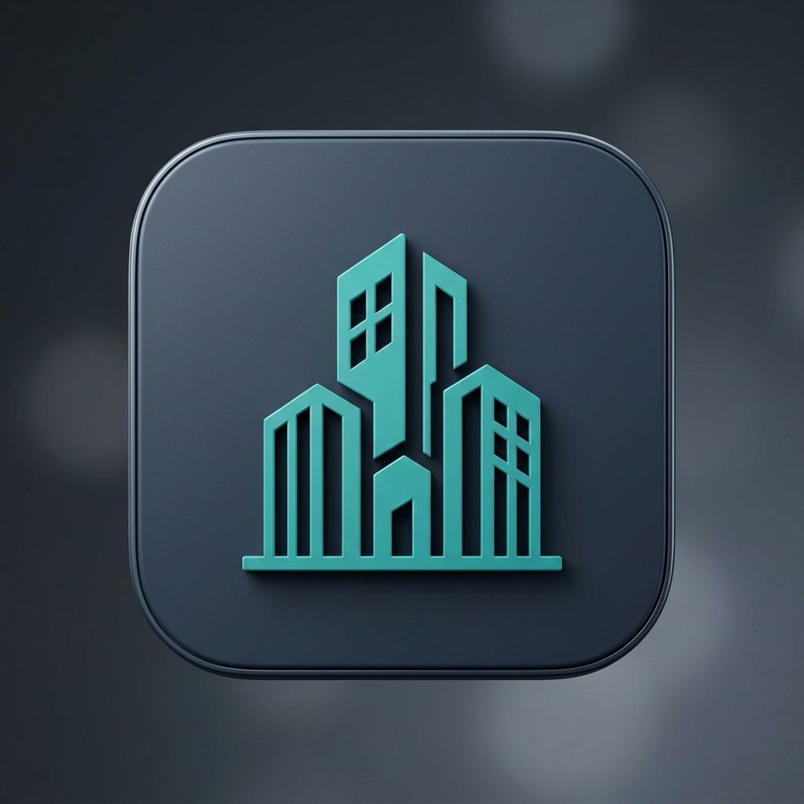
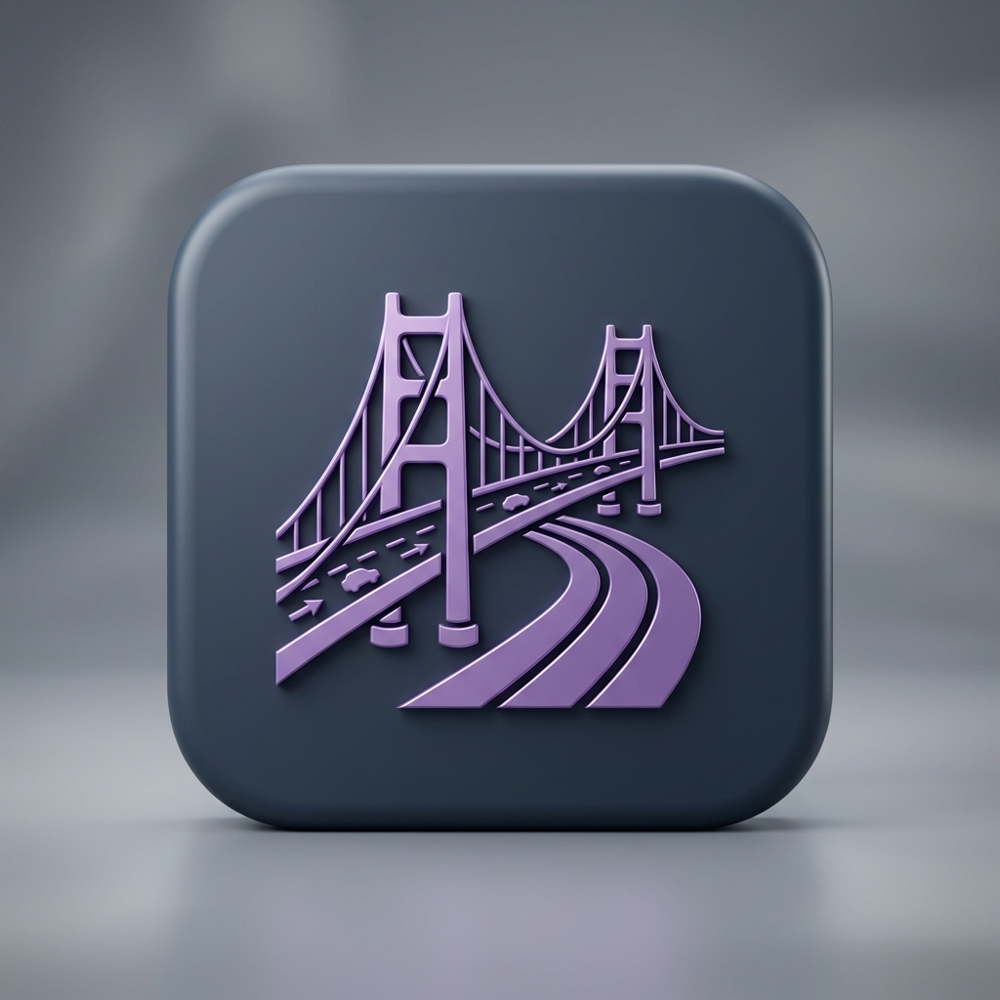
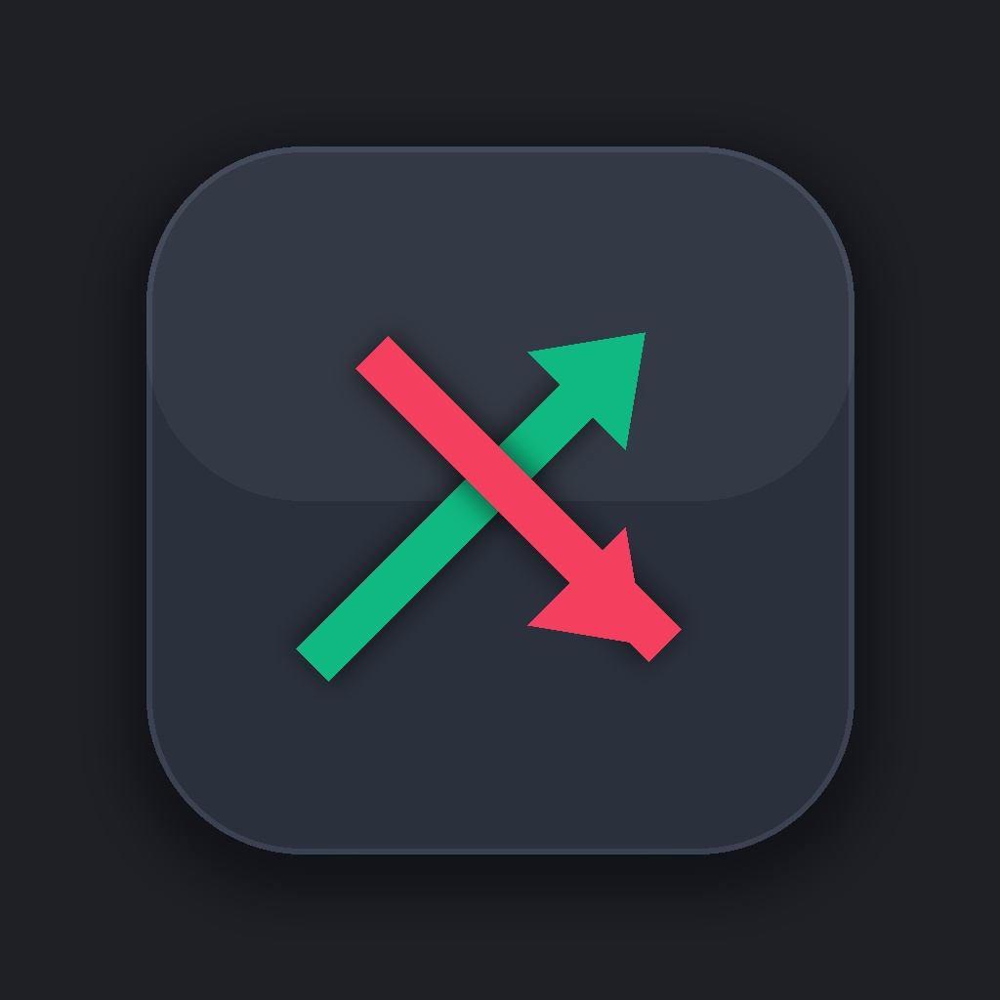
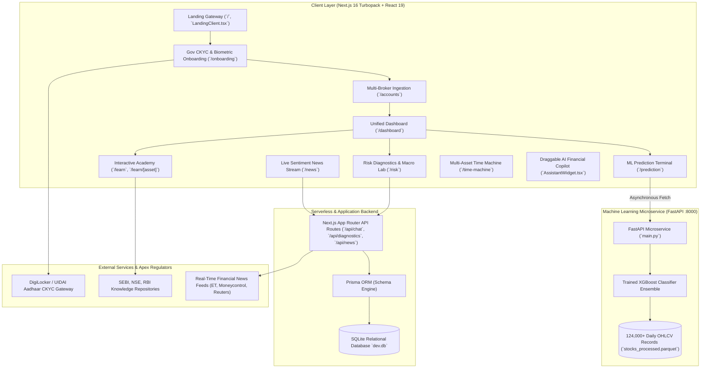

<div align="center">



# **Unify — All Your Investments, In One Place 🚀**

### **Institutional-Grade Multi-Broker Portfolio Telemetry, Quantitative Risk Lab & ML Forecasting Platform**

[](https://github.com/aadiitya2007/Hack_On_Tracks)
[-black?style=for-the-badge&logo=next.js)](https://nextjs.org/)
[](https://react.dev/)
[](https://www.typescriptlang.org/)
[](https://tailwindcss.com/)
[](https://fastapi.tiangolo.com/)
[](https://xgboost.readthedocs.io/)
[](https://www.prisma.io/)

*Engineered with precision for **Hack-On-Tracks 2026** by **Team God's Plan**.*

[Executive Summary](#-executive-summary--the-indian-retail-investing-gap) • [System Architecture](#-system-architecture) • [Visual Showcase](#-platform-visual-showcase) • [Core Capabilities](#-core-platform-capabilities) • [Mathematical Formulations](#-risk-engine-mathematics--regulatory-guardrails) • [Local Setup](#-local-installation--quickstart-guide) • [Team God's Plan](#-team-gods-plan)

---

</div>

## 📌 Executive Summary & The Indian Retail Investing Gap

In India's fast-growing retail financial markets, investors maintain accounts across multiple segregated brokerages (**Zerodha Kite, Groww, Upstox Pro, Angel One, ICICI Direct**). This creates severe operational fragmentation, hidden recurring costs, and hazardous blind spots:

1. **Recurring Depository Participant (DP) Charge Leakages**: Holding overlapping scrips across 2 to 3 brokerages bleeds capital through redundant annual DP fees and debit transaction charges (~₹420/year per duplicated stock holding across CDSL/NSDL).
2. **Blind Multi-Asset Risk Exposure**: Retail investors have no unified system to calculate their true consolidated Annualized Volatility ($\sigma_{\text{ann}}$), Herfindahl-Hirschman asset concentration (HHI), or 95% 1-Month Value-at-Risk (VaR) across segregated accounts.
3. **Severe Knowledge Deficit in Defensive & High-Yield Assets**: Despite India's booming infrastructure and commercial real estate markets, less than **3% of retail portfolios** allocate to **REITs**, **InvITs**, **Sovereign Green/G-Sec Bonds**, or **Gold/Index ETFs**, often due to complex jargon and lack of visual learning.
4. **Dangerous Derivatives Over-Exposure**: As highlighted by SEBI's landmark empirical study, **9 out of 10 individual retail traders in equity Futures & Options (F&O) incur net financial losses**, primarily driven by reckless leverage and gambling mentalities rather than statistical machine learning and hedging.

### 💡 The Unify Solution
**Unify** bridges this gap by unifying cross-broker portfolio data into an institutional-grade operating system with real-time risk telemetry, automated duplicate scrip detection, machine learning directional forecasts, and interactive visual masterclasses.

---

## 📸 Platform Visual Showcase

### 1. Trusted Multi-Broker Ingestion & Regulatory CKYC
<div align="center">
  <table>
    <tr>
      <td align="center" width="25%"><br /><b>Zerodha Kite</b></td>
      <td align="center" width="25%"><br /><b>Groww</b></td>
      <td align="center" width="25%"><br /><b>Upstox Pro</b></td>
      <td align="center" width="25%"><br /><b>CDSL / NSDL CAS</b></td>
    </tr>
    <tr>
      <td align="center" width="25%"><br /><b>UIDAI Aadhaar CKYC</b></td>
      <td align="center" width="25%"><br /><b>DigiLocker Gateway</b></td>
      <td align="center" width="25%"><br /><b>NSDL PAN Verification</b></td>
      <td align="center" width="25%"><br /><b>Biometric WebRTC Auth</b></td>
    </tr>
  </table>
</div>

### 2. 7 Asset Class Masterclasses with Real-World Imagery
<div align="center">
  <table>
    <tr>
      <td align="center" width="25%"><br /><b>Equities & Bluechips</b></td>
      <td align="center" width="25%"><br /><b>Mutual Fund Baskets</b></td>
      <td align="center" width="25%"><br /><b>Exchange Traded Funds</b></td>
      <td align="center" width="25%"><br /><b>G-Sec & Corporate Bonds</b></td>
    </tr>
    <tr>
      <td align="center" width="25%"><br /><b>Commercial REIT IT Parks</b></td>
      <td align="center" width="25%"><br /><b>Highway & Power InvITs</b></td>
      <td align="center" width="25%"><br /><b>Futures & Options Leverage</b></td>
      <td align="center" width="25%"><br /><b>Verified Financial Vault</b></td>
    </tr>
  </table>
</div>

---

## 🏗️ System Architecture



---

## ⚡ Core Platform Capabilities

### 1. 🆔 Government CKYC & WebRTC Live Biometric Onboarding (`/onboarding`)
* **8-Step Frictionless Identity Pipeline**:
  1. **Personal Information**: Collects full name, email, and phone number with instant keyboard `<Enter>` rapid advance.
  2. **NSDL Depository PAN Verification**: Live PAN format parsing with simulated NSDL verification.
  3. **Mobile OTP Verification**: 6-digit OTP verification with instant testing bypass (`123456`).
  4. **DigiLocker & UIDAI Aadhaar CKYC**: Redirects to verified DigiLocker gateway simulation with official Aadhaar branding.
  5. **WebRTC Biometric Face Auth**: Real camera feed integration, face alignment mesh, active laser scanner animation, and biometric hash match.
  6. **Multi-Broker Connection**: Connects Zerodha Kite, Groww, Upstox Pro, Angel One, and CDSL CAS.
  7. **Client-Side Financial P&L Validator**: Inspects uploaded files (`.pdf`, `.csv`, `.xlsx`) against financial contract note keywords (`P&L`, `Tax`, `CAS`, `Holdings`, `ISIN`), blocking non-financial documents.
  8. **Trader Classification Assessment**: Automatically assesses risk profile and categorizes investor as **Fresher**, **Beginner**, **Intermediate**, **Advanced**, or **Pro Trader**.

---

### 2. 📊 Consolidated Multi-Broker Telemetry Dashboard (`/dashboard`)
* **Multi-Broker Portfolio Aggregation**: Merges net portfolio valuation, day's change, and unrealized returns across all connected brokers in one unified view.
* **Active Trader Classification Tier**: Synchronizes live telemetry with the user's assessed tier (`Fresher`, `Beginner`, `Intermediate`, `Advanced`, `Pro`).
* **Multi-Timeframe Benchmark Engine**: Interactive chart (`1M`, `6M`, `1Y`, `3Y`, `ALL`) allowing live alpha benchmarking against **Nifty 50**, **Sensex**, or **Gold**.
* **Scrip Overlap & DP Fee Leak Detection**: Scans multi-broker portfolios for duplicate stock holdings (e.g., holding Reliance on both Zerodha and Groww) and computes annual Depository Participant (DP) fee savings.
* **Granular Asset Allocation**: Recharts interactive donut visualization breaking down holdings across Stocks, Mutual Funds, ETFs, Bonds, REITs, InvITs, and Cash.

---

### 3. 🛡️ Quantitative Risk Diagnostic & Macro Stress-Testing Lab (`/risk`)
* **Composite Risk Score (0–100)**: Evaluates weighted portfolio risk based on Annualized Volatility ($\sigma$), Herfindahl Concentration Index (HHI), Maximum Historical Drawdown (MDD), and derivative leverage penalties.
* **6 Core Quantitative Risk Metrics**:
  * **Annualized Volatility ($\sigma_{\text{ann}}$)**: Standard deviation over 252 trading days.
  * **95% 1-Month Value-at-Risk (VaR in ₹)**: Maximum expected rupee drawdown at a 95% confidence interval.
  * **Maximum Historical Drawdown (MDD %)**: Peak-to-trough crash decline percentage.
  * **Herfindahl Concentration Index (HHI)**: Asset class over-concentration metric.
  * **Sharpe Ratio Efficiency**: Risk-adjusted excess return over the 6.5% risk-free rate.
* **Interactive Macroeconomic Stress-Testing**:
  * 📉 *Tech Bubble Correction (-18.4% Tech, +3.1% Bonds)*
  * 🏦 *RBI 50 bps Repo Rate Hike (-4.2% Equities, -1.8% Long Bonds, +0.8% Liquid Funds)*
  * 🛢️ *Global Crude Oil Spike (+22% Energy, -6.8% Financials & FMCG)*
  * 🛡️ *1-Click Defensive Rebalancing Basket Deployment* modal linked to execution.
* **Actionable Risk Mitigation Buttons**:
  * 🛡️ *Deploy Defensive Rebalancing Basket* modal with one-click portfolio stabilization.
  * 🔄 *Rebalance to Balanced Risk Profile* with simulated risk-score normalization.

---

### 4. 🤖 XGBoost ML Stock Directional Prediction Engine (`/prediction`)
* **FastAPI Machine Learning Microservice**: Python backend trained on **124,000+ daily OHLCV historical records** across 50 top Indian equities.
* **Strict Chronological Data Split**: 80/20 train/test split with zero future lookahead data leakage.
* **Feature Engineering Pipeline**:
  * 14-day Relative Strength Index (RSI)
  * 10-day and 50-day Exponential Moving Average (EMA) ratios
  * 20-day rolling annualized volatility
  * Lagged price returns (`return_1d`, `return_5d`)
  * Volume momentum and OBV indicators
* **Institutional Telemetry Output**: Directional prediction (*Bullish* vs. *Bearish*), probability confidence percentage, test set accuracy vs. naïve baseline, precision, recall, F1-score, feature importance rankings, and confusion matrix.

---

### 5. 📚 Interactive Financial Masterclasses & Knowledge Academy (`/learn`, `/learn/[asset]`)
* **7 Asset Class Curriculum**: Dedicated modules for **Stocks**, **Mutual Funds**, **ETFs**, **Bonds**, **REITs**, **InvITs**, and **Futures & Options (F&O)**.
* **Interactive Visual Concept Simulators**:
  * 🏢 **REIT Skyscraper Simulator**: Build commercial Grade-A office floors and watch rental yield dividends accrue with high-contrast UI.
  * 🍕 **Pizza Diversification Visualizer**: Slice allocator illustrating equity risk vs. mutual fund basket diversification.
  * 🪙 **Bond Certificate & Coupon Streamer**: Simulate sovereign G-Sec yield drops and coupon cash distributions.
  * 🚗 **InvIT Toll Highway Plaza**: Toll revenue collection simulator demonstrating infrastructure cash flows.
  * ⚡ **F&O Leverage Shield**: Call/Put position multiplier demonstrating asymmetric risk and theta time decay.
* **Interactive Knowledge Challenges (5 Questions Per Module)**:
  * 5 comprehensive, content-grounded multiple choice questions for every single module (35 questions total).
  * Step-by-step interactive quiz stepper with live progress bar and instant score counter.
  * High-contrast immediate answer feedback with detailed educational explanations.
  * Completion trophy screen with percentage score and full review breakdown.
* **Curated Official Knowledge Vault**:
  * High-contrast, structured knowledge cards linking to official regulatory resources:
  * **SEBI Official Portals**: SCORES 2.0, Investor Charter, and F&O Retail Loss Empirical Study.
  * **NSE India Portals**: Order book matching guides, swing trading telemetry, ETF handbooks, and InvIT portals.
  * **RBI Retail Direct**: Gilt account walkthroughs, Treasury Bills, and Sovereign Green Bonds.
  * **Institutional Masterclasses**: In-app YouTube video modal player with zero distractions.

---

### 6. 📰 Animated Financial Market News Stream (`/news`)
* **Live Financial News Aggregator**: Real-time business updates ingested from **The Economic Times, Times of India (Business), Moneycontrol, Financial Express, and Reuters**.
* **Automated Sentiment Classification**: Filter headlines by sentiment tag (*BULLISH / BEARISH / NEUTRAL*), market impact, and publisher category.
* **Fluid Animation**: Framer Motion staggered entrance animations with live market ticker indicators.

---

### 7. ⏰ Multi-Asset Time Machine Historical SIP Simulator (`/time-machine`)
* **Historical Backtesting Engine**: Simulate Lump Sum and Monthly SIP compounding growth across Equities, Bonds, REITs, InvITs, and Mutual Funds over custom date ranges.
* **Drawdown & Pain Index Analytics**: Calculates historical CAGR, Maximum Historical Drawdown, and rolling calendar year returns.

---

### 8. 💬 Draggable Unify AI Financial Assistant (`AssistantWidget.tsx`, `/api/chat`)
* **Viewport-Free Draggable Panel**: Floating assistant window with drag handles that can be freely positioned anywhere on the screen.
* **Structured Typography & Markdown Parser**: Renders formatted markdown, numbered badges, bullet points, and clickable in-app navigation pills (`/risk`, `/prediction`, `/learn`).
* **Conversational Awareness**: Contextually understands user portfolio metrics, answered quizzes, and macro scenarios.

---

## 📐 Risk Engine Mathematics & Regulatory Guardrails

The composite Portfolio Risk Score ($0 \le R \le 100$) is computed in [`src/lib/risk-analytics.ts`](src/lib/risk-analytics.ts):

$$R = 0.40 \cdot S_{\text{vol}} + 0.30 \cdot S_{\text{conc}} + 0.30 \cdot S_{\text{drawdown}} + P_{\text{leverage}}$$

### 1. Annualized Portfolio Volatility ($S_{\text{vol}}$)
Computed via the 7×7 cross-asset covariance matrix ($\mathbf{\Sigma}$) scaled over a 252-day Indian trading year:

$$\sigma_{\text{ann}} = \sqrt{252 \cdot \mathbf{w}^T \mathbf{\Sigma} \mathbf{w}}$$

Where $\mathbf{w} = [w_{\text{stocks}}, w_{\text{mfs}}, w_{\text{etfs}}, w_{\text{bonds}}, w_{\text{reits}}, w_{\text{invits}}, w_{\text{fno}}]^T$ represents the normalized portfolio asset weight vector ($\sum w_i = 1$).

### 2. Herfindahl-Hirschman Concentration Index ($S_{\text{conc}}$)
Quantifies single-asset or single-domain over-concentration:

$$\text{HHI} = \sum_{i=1}^{7} (w_i \cdot 100)^2 \quad \implies \quad S_{\text{conc}} = \min\left(100, \frac{\text{HHI}}{100}\right)$$

### 3. Maximum Historical Drawdown ($S_{\text{drawdown}}$)
Weighted historical stress decline computed from historical crash profiles (e.g., 2008 GFC, 2020 COVID shock):

$$\text{MDD} = \sum_{i=1}^{7} w_i \cdot \text{MDD}_i$$

### 4. Parametric 95% 1-Month Value-at-Risk ($\text{VaR}_{0.95}$)
Estimated 30-day maximum capital loss at a 95% confidence interval ($z = 1.645$):

$$\text{VaR}_{0.95} = \text{Portfolio Value} \times 1.645 \times \frac{\sigma_{\text{ann}}}{\sqrt{12}}$$

---

## 💻 Tech Stack & Dependencies

| Layer | Technologies |
| :--- | :--- |
| **Frontend Framework** | **Next.js 16.4.0 (Turbopack)**, **React 19.3.0**, **TypeScript 5** |
| **Styling & Design System** | **Tailwind CSS v4.0**, CSS Variables, High-Contrast Typography |
| **Animation & Motion** | **Framer Motion 14.0**, Custom SVG Canvas Visualizers |
| **Data Visualization** | **Recharts 3.10.1**, Custom Canvas Visualizers, SVG Gauges |
| **Backend & APIs** | Next.js App Router API Routes (`/api/chat`, `/api/diagnostics`, `/api/news`) |
| **Database & ORM** | **Prisma 6.19.3**, SQLite Database (`prisma/dev.db`) |
| **Machine Learning Service** | **Python 3.9+**, **FastAPI**, **XGBoost Classifier**, **scikit-learn**, **pandas** |
| **Historical Dataset** | **124,000+ Daily Records** across 50 Indian Equities (`stocks_processed.parquet`) |
| **Identity & Biometrics** | **WebRTC MediaStream Camera API**, Canvas Image Hashing, DigiLocker Gateway |

---

## 🚀 Local Installation & Quickstart Guide

### Prerequisites
* **Node.js**: `v18.0.0` or higher (Recommended: Node `v20+`)
* **npm**: `v9.0.0` or higher
* **Python**: `v3.9` or higher

---

### Step 1: Clone Repository
```bash
git clone https://github.com/aadiitya2007/Hack_On_Tracks.git
cd Hack_On_Tracks
```

### Step 2: Install Frontend Dependencies & Setup Database
```bash
# 1. Install Node.js dependencies
npm install

# 2. Generate Prisma Client
npx prisma generate

# 3. Synchronize database schema (SQLite)
npx prisma db push --accept-data-loss

# 4. Seed initial telemetry and portfolio records
npx tsx scripts/seed-prod.ts
```

### Step 3: Setup Python ML Service & Train XGBoost Models
```bash
# 1. Create and activate Python virtual environment
python3 -m venv data_venv
source data_venv/bin/activate       # On Windows: data_venv\Scripts\activate

# 2. Install ML requirements
pip install -r ml-service/requirements.txt

# 3. Train XGBoost classifier on the 124,000+ record Parquet dataset
cd ml-service
python train.py
cd ..
```

### Step 4: Run Application Services

#### Terminal 1: Next.js Frontend Server
```bash
npm run dev
```
> The application will be live at: **`http://localhost:3000`**

#### Terminal 2: FastAPI Machine Learning Service
```bash
source data_venv/bin/activate
cd ml-service
uvicorn main:app --host 0.0.0.0 --port 8000 --reload
```
> The FastAPI service will be live at: **`http://localhost:8000`** (Interactive docs at `/docs`)

---

## 🧪 Verification & Production Build

To verify that all types, static routes, server components, and styling compile without errors:

```bash
# Run production build
npm run build
```

Expected output:
```text
▲ Next.js 16.4.0 (Turbopack)
✓ Compiled successfully
✓ Generating static pages (23/23)
✓ Finalizing page optimization
```

---

## 👥 Team God's Plan

Engineered with passion for **Hack-On-Tracks 2026**:

* **Aadiitya Agarrwal**
* **Aryan Amilkanthwar**
* **Advait Ambarkar**
* **Tanay Bhutada**

---

## 🛡️ Compliance & Educational Disclaimer

**Unify** is an experimental fintech platform developed for competition and demonstration purposes. All predictions, probability scores, risk diagnostic calculations, and simulations are statistical models intended strictly for analytical and educational purposes. Unify does not provide SEBI-registered investment advice or individual buy/sell recommendations.

---

<div align="center">
  <b>Built with ❤️ by Team God's Plan for Hack-On-Tracks</b>
</div>
